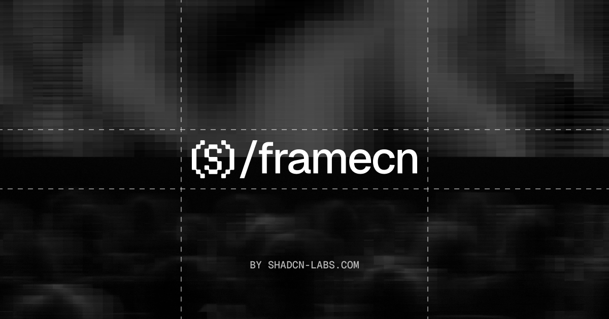

  

<h1 align="center">framecn</h1>

  Ready-to-use, customizable video components for React, with free open-source components and framecn Pro compositions. 
  Built on <a href="https://editframe.com">Editframe</a>, with free components installable through <a href="https://ui.shadcn.com/">shadcn/ui</a>.

  
  
  
  

  <a href="https://framecn.dev/docs">Get Started</a> ·
  <a href="https://framecn.dev/docs/installation">Installation</a> ·
  <a href="https://framecn.dev/components">Components</a> ·
  <a href="https://framecn.dev/pricing">Pricing</a>

## Features

- 🎬 **Editframe integration** — Build video compositions with HTML, React, and CSS
- 📹 **Cloud rendering** — Export to MP4 via Editframe's render infrastructure
- 📦 **shadcn/ui compatible** — Uses the same registry format and CLI
- 🧩 **Composable** — Build complex videos with simple, declarative components
- ⏱️ **Timeline control** — Precise timing and sequencing of video elements
- 🎬 **Multi-layer composition** — Stack videos, images, text, and effects
- 🤖 **AI-ready** — Perfect for generating videos programmatically

## Sponsors

<!-- sponsors:start -->
<!-- Keep tier order and placed logos in sync with lib/sponsors.ts. -->
<table>
  <tbody>
    <tr>
      <td colspan="3"><strong>Diamond Sponsors</strong></td>
    </tr>
    <tr>
      <td align="center"><a href="https://framecn.dev/sponsor#plans">Your logo here</a></td>
      <td></td>
      <td></td>
    </tr>
    <tr>
      <td colspan="3"><strong>Gold Sponsors</strong></td>
    </tr>
    <tr>
      <td align="center"><a href="https://framecn.dev/sponsor#plans">Your logo here</a></td>
      <td></td>
      <td></td>
    </tr>
    <tr>
      <td colspan="3"><strong>Silver Sponsors</strong></td>
    </tr>
    <tr>
      <td align="center"><a href="https://framecn.dev/sponsor#plans">Your logo here</a></td>
      <td></td>
      <td></td>
    </tr>
  </tbody>
</table>
<!-- sponsors:end -->

> Found framecn useful? [Become a sponsor](https://framecn.dev/sponsor#plans) to support maintenance and get your logo here and on the site, with placement based on your tier.

## Community

The framecn community lives on [GitHub](https://github.com/shadcn-labs/framecn), where you can ask questions, share ideas, and show what you've built.

## Contributing

Contributions are welcome. See [CONTRIBUTING.md](CONTRIBUTING.md) to get the repo running locally and land a change, and use [issues](https://github.com/shadcn-labs/framecn/issues) and [discussions](https://github.com/shadcn-labs/framecn/discussions) to collaborate. By participating, you agree to the [Code of Conduct](./CODE_OF_CONDUCT.md).

## Security

Please do not open public issues for security vulnerabilities. Follow [SECURITY.md](./SECURITY.md) and report them privately through GitHub Security Advisories.

## License

- [MIT](LICENSE) for all original code.
- Free captions in `registry/bases/editframe/components/` are adapted from [HyperFrames](https://github.com/heygen-com/hyperframes) — Apache-2.0, © 2026 HeyGen, Inc. Each file keeps an attribution header.

## Star History

<a href="https://www.star-history.com/?repos=shadcn-labs%2Fframecn&type=date&legend=top-left">
 <picture>
   <source media="(prefers-color-scheme: dark)" srcset="https://api.star-history.com/chart?repos=shadcn-labs/framecn&type=date&theme=dark&legend=top-left&sealed_token=Y57mSprjn7uT0MjlKlSNyToEuYvZHvGxID6vUI9K_VxHA5vfhAINmbTs6nc_cVFLlt0P6GwGz8OJkwYLgsVqmPh2wBoP7wr2lLtQTaRXwdnm6n5eTclAfnbNtdNBGPmtOM1d0p_Dwp9sLRUxK489V0p-zb3lALJLEqde2MhcXciEPUsY8J-VKi28VfFq" />
   <source media="(prefers-color-scheme: light)" srcset="https://api.star-history.com/chart?repos=shadcn-labs/framecn&type=date&legend=top-left&sealed_token=Y57mSprjn7uT0MjlKlSNyToEuYvZHvGxID6vUI9K_VxHA5vfhAINmbTs6nc_cVFLlt0P6GwGz8OJkwYLgsVqmPh2wBoP7wr2lLtQTaRXwdnm6n5eTclAfnbNtdNBGPmtOM1d0p_Dwp9sLRUxK489V0p-zb3lALJLEqde2MhcXciEPUsY8J-VKi28VfFq" />
   
 </picture>
</a>
